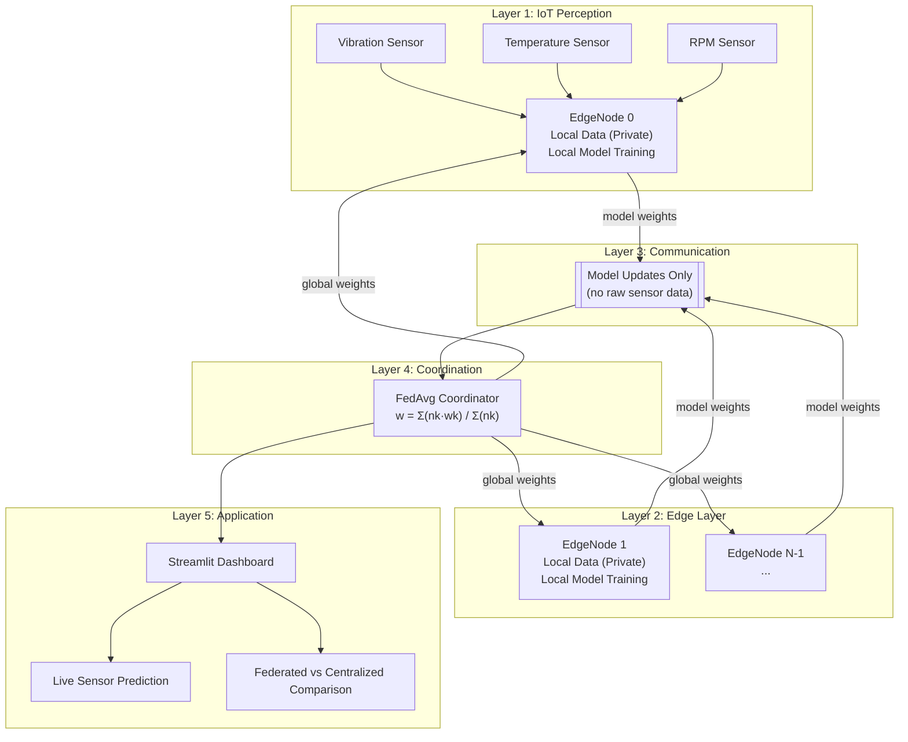

# FedEdge-IoT: Architecture Documentation

## System Overview

FedEdge-IoT is a **software simulation** of federated learning across multiple IoT edge nodes.
All components run as Python objects within a single application — no real hardware, real network,
or real sensor devices are used.

---

## Five-Layer Architecture

```
┌─────────────────────────────────────────────────────────┐
│  LAYER 5: Application Layer                             │
│  Streamlit Dashboard · Plotly Charts · Live Prediction  │
└──────────────────────────┬──────────────────────────────┘
                           │
┌──────────────────────────▼──────────────────────────────┐
│  LAYER 4: Fog / Cloud Coordination Layer                │
│  FedAvgCoordinator                                      │
│  - Receives model updates from nodes                    │
│  - Applies weighted average: w = Σ(n_k·w_k) / Σ(n_k) │
│  - Broadcasts updated global model                      │
└──────────────────────────┬──────────────────────────────┘
                           │ (model weights only — no raw data)
┌──────────────────────────▼──────────────────────────────┐
│  LAYER 3: Communication Layer                           │
│  Simulated network: counts bytes, tracks rounds         │
│  Federated: model updates · Centralized: raw records    │
└──────────────────────────┬──────────────────────────────┘
                           │
┌──────────────────────────▼──────────────────────────────┐
│  LAYER 2: Edge Layer                                    │
│  EdgeNode 0 │ EdgeNode 1 │ … │ EdgeNode N               │
│  Local data (PRIVATE) · Local model · Local training    │
└──────────────────────────┬──────────────────────────────┘
                           │
┌──────────────────────────▼──────────────────────────────┐
│  LAYER 1: IoT Perception Layer                          │
│  Simulated vibration sensors, temperature, RPM          │
│  Generated by data_generator.py (synthetic)             │
└─────────────────────────────────────────────────────────┘
```

---

## Module Descriptions

| Module | Layer | Responsibility |
|--------|-------|---------------|
| `data_generator.py` | L1 | Synthetic sensor data generation |
| `edge_node.py` | L2 | EdgeNode class: local data, training, updates |
| `model.py` | L2/L4 | MLP architecture, weight extraction/injection |
| `fedavg.py` | L4 | FedAvgCoordinator: broadcast, collect, aggregate |
| `centralized.py` | L4 | Centralized training baseline |
| `communication.py` | L3 | Byte counting and communication accounting |
| `evaluation.py` | L5 | Metrics: accuracy, F1, confusion matrix, latency |
| `experiment.py` | All | Full experiment orchestrator |
| `app.py` | L5 | Streamlit dashboard |
| `config.py` | Global | Constants and configuration |

---

## Data Flow — Federated Mode

```
data_generator.py
  └─→ generates node_0 … node_N datasets (non-IID)
        └─→ each EdgeNode stores its private local_data
              ║
              ║  Round r:
              ║
              ╠═══ FedAvgCoordinator broadcasts global_weights ══╗
              ║    (model_bytes × N nodes downloaded)            ║
              ║                                                   ║
              ╠═══ EdgeNode.train_local(local_epochs) ═══════════╣
              ║    (local data NEVER leaves the node)             ║
              ║                                                   ║
              ╠═══ EdgeNode.get_model_update() ══════════════════╣
              ║    (weight arrays uploaded — not raw records)     ║
              ║                                                   ║
              ╚═══ FedAvgCoordinator.federated_average() ════════╝
                   (weighted average → new global_weights)
                        └─→ evaluation on held-out test set
```

## Data Flow — Centralized Mode

```
data_generator.py
  └─→ ALL node datasets pooled on server
        └─→ model trained on combined data
              └─→ evaluation on same held-out test set
                    └─→ comparison with federated results
```

---

## Non-IID Data Heterogeneity

Each simulated edge node uses a different **machine profile** with:
- Different RPM range and variance
- Different noise amplitude
- Different fault rate (configurable)

This simulates a realistic industrial fleet where machines vary in:
- Age and condition
- Operating load
- Sensor calibration

Non-IID data is a known challenge in federated learning — it can cause the global model
to converge more slowly or to a suboptimal point compared to centralized training.

---

## Communication Accounting Assumptions

1. **Float64** (8 bytes per parameter) — no quantisation
2. **CSV** row estimate for raw records: 80 bytes per record
3. **No compression** applied (conservative estimate)
4. **Excludes**: TCP/IP headers, TLS overhead, DNS, authentication
5. **Evaluation records** excluded from training communication counts
6. Both upload AND download traffic counted for federated mode

---

## Mermaid Architecture Diagram



